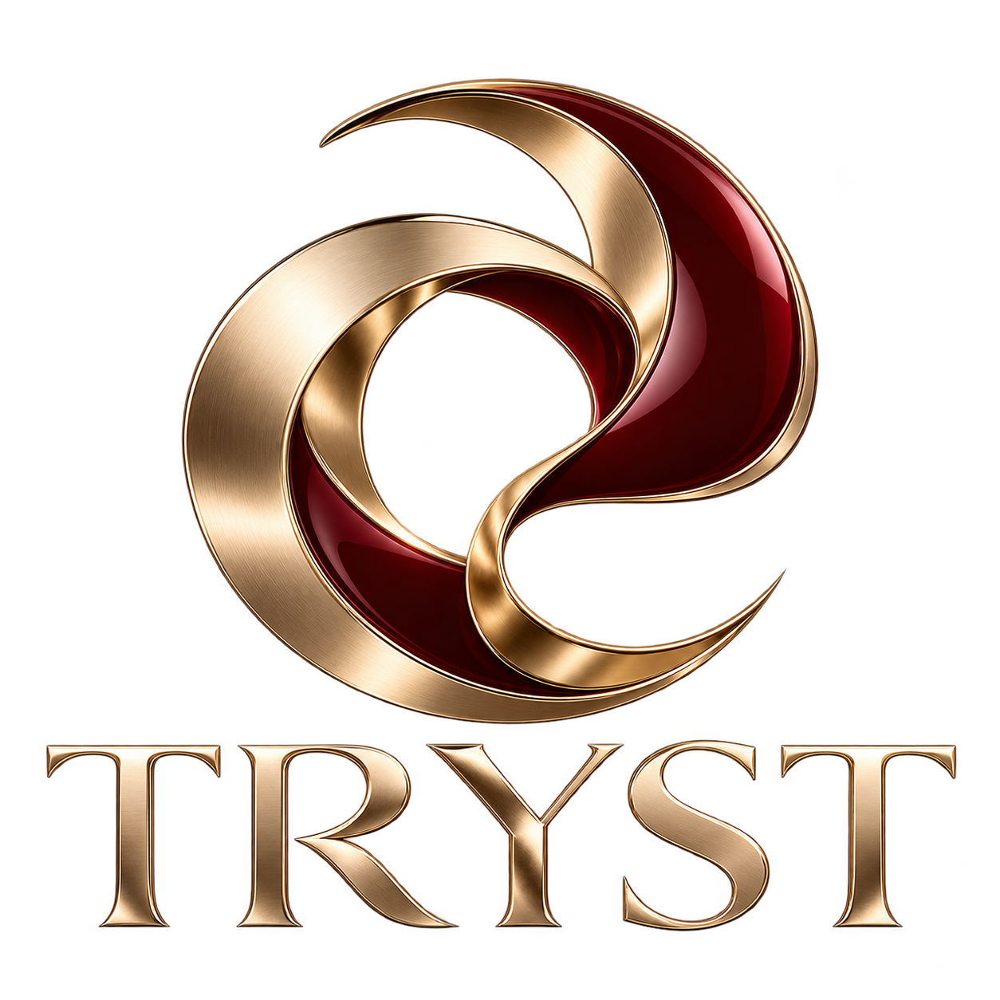

# TRYST

**Private chemistry. Intelligent discretion.** — *Discretion is the product.*

TRYST is a discretion-first connection platform for attached adults, solo adults open to couples, and couples: one-off and ongoing connections, threesomes and couple-to-couple, for all genders and orientations.

## Current specification — v1.3 baseline

Start at [`docs/spec/00_README.md`](docs/spec/00_README.md).

| Document | For |
|---|---|
| [01 Product](docs/spec/01_Product.md) | Leadership, product, investors, counsel |
| [02 Shared Contracts](docs/spec/02_Shared_Contracts.md) | Backend **and** frontend — data model, API, enums, schemas, FR/NFR catalogue |
| [03 Backend](docs/spec/03_Backend.md) | Backend, ML, security, SRE, T&S engineering |
| [04 Frontend](docs/spec/04_Frontend.md) | iOS, Android, web, design |
| [05 Terms of Service — draft 0.9.5](docs/spec/05_Terms_of_Service_draft.md) | Counsel (not for publication) |
| [06 Decisions, errata, change log](docs/spec/06_Decisions_and_Changes.md) | Product owner, tech leads |
| [07 Source B — founder brief (verbatim)](docs/spec/07_Source_B_Founder_Brief.md) | Everyone — the founder's specification word for word, with traceability |
| [08 Source A — traceability](docs/spec/08_Source_A_Traceability.md) | Everyone — where each section of the consolidated Spec + ToS lives in the spec and code |
| [09 Operating System (internal)](docs/spec/09_Operating_System.md) | Everyone — agent workforce and governance, command centres, self-managing layer, BitriPay door, connectors, ops/partner APIs, B2B licensing |
| [Combined PDF](docs/spec/TRYST_Spec_v1.3.pdf) | Reading and sharing |

Consistency check (runs in CI): `python3 scripts/check_spec.py`

## Repository layout

Three parts, each built, tested and deployed on its own. They meet only through `shared/`.

| Path | What | Deploys as | CI |
|---|---|---|---|
| [`frontend/`](frontend/README.md) | Next.js web app (member site; the staff console is the same code built with `OPS_CONSOLE=1`). Talks to the backend only over HTTP (`/v1/*` proxied to `IDENTITY_URL` / `SAFETY_URL`) | Vercel or a container (`frontend/Dockerfile`) | `frontend.yml` |
| [`backend/`](backend/README.md) | Go services: `identity-svc` (the member API) and `safety-svc` (Trust & Safety), one image, two entrypoints; PostgreSQL | Containers (`backend/Dockerfile`) | `backend.yml` |
| [`shared/`](shared/README.md) | The contract between them: OpenAPI and Protobuf contracts, controlled vocabularies, test vectors both sides must pass, brand assets | Nothing to deploy | `shared.yml` |
| `agents/`, `crypto-core/`, `mobile/` | Python agents, Rust media crypto, native app requirements | — | `backend.yml` |
| `deploy/` | Docker Compose, Terraform, monitoring | — | `integration.yml` |

`integration.yml` runs the browser end-to-end tests against both parts together and scans the images. Run everything locally with `make check`; go-live: [docs/runbooks/go-live.md](docs/runbooks/go-live.md).

## Sources and history

- `docs/source/` — founder source documents (consolidated Spec + ToS, 4 Oct 2026; Developer Specification, 17 Sep 2026)
- `shared/brand/` — logo (exactly as supplied) and colour tokens
- `docs/archive/` — superseded drafts (PRD v0.1 and the v1.0-vs-v0.1 reconciliation)
